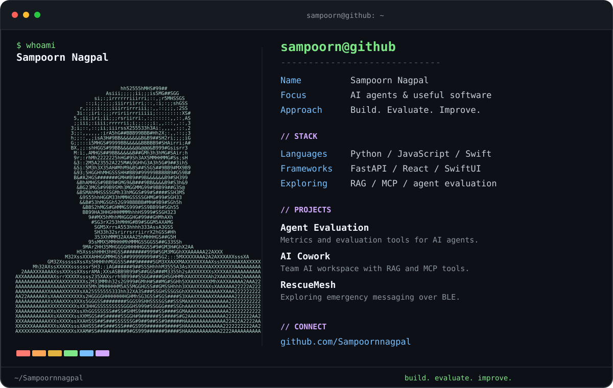

  

  <a href="https://github.com/Sampoornnagpal/Agent-Evaluation">Agent Evaluation</a> &nbsp; / &nbsp;
  <a href="https://github.com/Sampoornnagpal/coworkAI">AI Cowork</a> &nbsp; / &nbsp;
  <a href="https://github.com/Sampoornnagpal/RescueMesh_iOS">RescueMesh · iOS</a> &nbsp; / &nbsp;
  <a href="https://github.com/Sampoornnagpal/RescueMesh_Android">RescueMesh · Android</a>

About me · text version

I'm **Sampoorn Nagpal**. I build AI tools and explore how to evaluate agents and connect useful systems.

- **Agent Evaluation** — evaluation tools with FastAPI, React and DeepEval.
- **AI Cowork** — a team AI workspace with document RAG, MCP tools and an LLM gateway.
- **RescueMesh** — exploring emergency messaging over Bluetooth Low Energy.

My project stack includes **Python, JavaScript, Swift, FastAPI, React and SwiftUI**.

